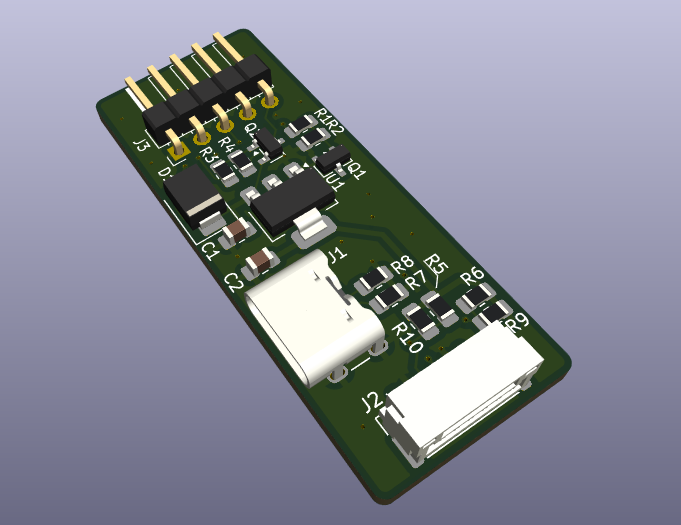

# SEN6x_to_KEL_adapter

Adapter board that connects a **Sensirion SEN6x** environmental sensor (SEN63C, SEN65, SEN66, SEN68…) to a **KEL I²C interface**. The sensor is normally powered from the KEL connector, and it can also run from an **external USB-C power supply**. When USB-C power is present, the board switches over to it automatically.



Full schematic: [schematic.pdf](schematic.pdf)

## Features

- Passes I²C (SDA/SCL) straight from the KEL connector to the SEN6x sensor connector
- On-board 3.3 V LDO regulator (NCP1117-3.3) supplies the sensor
- Two power sources:
  - **KEL 5 V** (default)
  - **USB-C 5 V** (external, takes priority when plugged in)
- Automatic power-source selection with no jumpers needed
- I²C pull-ups to 3.3 V on board
- USB-C port is power-only, with CC termination so any standard USB-C charger delivers 5 V

## Connectors

### J3 – KEL I²C (Conn_01x05)

| Pin | Signal | Note |
|-----|--------|------|
| 1 | GND | |
| 2 | SDA | I²C data |
| 3 | SCL | I²C clock |
| 4 | NC | not connected |
| 5 | 5V | supply from KEL |

### J2 – SEN6x sensor (Conn_01x06)

| Pin | Signal |
|-----|--------|
| 1 | +3.3 V |
| 2 | GND |
| 3 | SDA |
| 4 | SCL |
| 5 | GND |
| 6 | +3.3 V |

The pinout matches the Sensirion SEN6x interface cable. The SEN6x default I²C address is `0x6B`.

### J1 – USB-C (power only)

This port is used only for external 5 V power and carries no USB data.

## How it works

### Power path

```
KEL 5V ──► Q2 (switch) ──┐
                         ├──► U1 NCP1117-3.3 ──► +3.3 V ──► SEN6x
USB VBUS ──► D1 (B230) ──┘
```

- **KEL supply only:** Q2 (BC817) is biased on through R4 (510 Ω) and passes the KEL 5 V to the LDO input.
- **USB-C connected:** VBUS feeds the LDO input through Schottky diode D1 (B230). At the same time, the R1/R2 divider (2 × 5.1 kΩ) turns on Q1 (BC817). Q1 pulls the base of Q2 low through R3 (510 Ω) and switches Q2 off. The sensor then runs from USB-C power and draws no current from the KEL 5 V rail.
- D1 blocks reverse current into the USB-C port while the board runs from KEL power.
- R7/R8 (5.1 kΩ) on CC1/CC2 are the standard USB-C sink (Rd) resistors. They make a USB-C source switch VBUS on.
- C1 (0.1 µF) and C2 (1 µF) are the input and output capacitors of the LDO.

### I²C

- SDA and SCL are pulled up to +3.3 V. Each line has two 5.1 kΩ footprints: R6/R9 on SDA and R5/R10 on SCL.
  - Fit one resistor per line for 5.1 kΩ.
  - Fit both resistors per line for about 2.55 kΩ, which suits longer cables or faster clocks.
- Bus levels are 3.3 V, so the KEL side must accept 3.3 V I²C logic.

## Bill of materials

| Ref | Value | Description |
|-----|-------|-------------|
| U1 | NCP1117-3.3 | 3.3 V LDO regulator, SOT-223 |
| Q1, Q2 | BC817 | NPN transistor, SOT-23 |
| D1 | B230 | Schottky diode |
| C1 | 0.1 µF | LDO input capacitor |
| C2 | 1 µF | LDO output capacitor |
| R1, R2 | 5.1 kΩ | VBUS sense divider |
| R3, R4 | 510 Ω | Q2 bias |
| R5, R6, R9, R10 | 5.1 kΩ | I²C pull-ups |
| R7, R8 | 5.1 kΩ | USB-C CC pull-downs (Rd) |
| J1 | USB-C receptacle | power-only, 6-pin |
| J2 | 6-pin connector | SEN6x sensor |
| J3 | 5-pin header | KEL I²C |

## Repository contents

| Path | Content |
|------|---------|
| `adapter/` | KiCad project (schematic and PCB) |
| `schematic.pdf` | schematic as a PDF |
| `PCB.png` | 3D render of the board |
